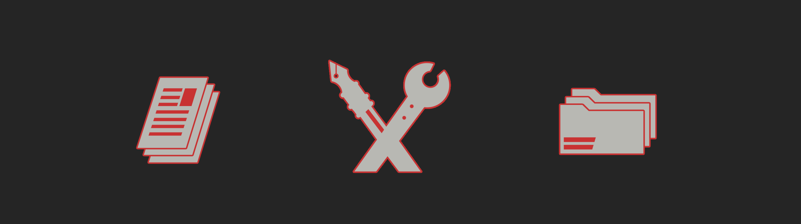

# **WORK PORTFOLIO**
---
Browse sample documents and technical references presenting my approach to technical writing, content organization, and end-user support.

- [**Product Overview**](https://hiredale.github.io/daleydose/)  
&#x20; View an introduction to an application's purpose, core features, navigation, and available resources.

- [**Help Files**](https://hiredale.github.io/daleydose/help-files)  
&#x20; View a centralized knowledge base of reference guides, window definitions, and step-by-step tutorials.

- [**Internal Release Notes**](https://hiredale.github.io/daleydose/release-note-internal-1.5)  
&#x20; View release notes intended for internal stakeholders, development teams, and company management.

<!--
- [**Customer Release Notes**](https://hiredale.github.io/daleydose/release-note-customer-1.5)  
&#x20; View updates intended for end-users.
-->

- [**Version History**](https://hiredale.github.io/daleydose/release-note-version-history)  
&#x20; View a chronological archive of previous software releases.

## **ABOUT ME**
---
A more detailed look at my previous work experience and what I can bring to the team.

- [**LinkedIn Profile**](https://www.linkedin.com/in/dalealbertgaddi/)  
  &#x20; Reach out for professional inquiries, career opportunities, or questions about my work.
  
- [**Why Hire Dale**](/why-hire-me)  
  &#x20; Understand my method when creating end‑user documentation.

- [**Work History**](/work-history)  
  &#x20; Read about my work history and specialization.

- [**Work Responsibilities**](/day-to-day)  
  &#x20; See the tasks I perform during a standard workday.

<!--  -->  

